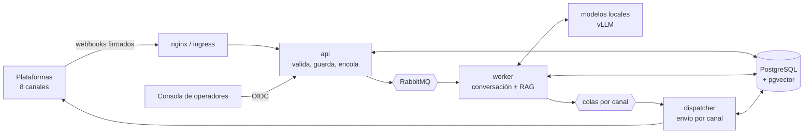

# IAMiArgentina 1.1

> Proyecto independiente. No es un servicio oficial de Mi Argentina ni del Estado nacional, no
> está vinculado a ningún organismo ni autorizado por él. Las respuestas de demostración salen de
> preguntas frecuentes públicas de argentina.gob.ar.

Plataforma de inteligencia artificial local para atención automatizada, recuperación de
información y comunicación multicanal. Recibe consultas por WhatsApp, Telegram, Instagram,
Messenger, mensajes directos de X, chat web, correo y SMS, las centraliza en un gestor de
conversaciones y las responde con modelos de lenguaje que corren en servidores propios, usando
solo la información de su base de conocimiento. Cuando hace falta, deriva la conversación a una
persona.

**Qué resuelve.** Atender por escrito a mucha gente a la vez, por el canal que cada persona ya usa,
con respuestas consistentes y con su fuente, sin mandar las consultas a servicios de IA de
terceros. Está diseñada para crecer por etapas hasta cientos de miles de personas por día y picos
de decenas de miles de conversaciones simultáneas, repartiendo el trabajo en varios servidores.

Es la evolución de una prueba de concepto de un solo canal (v1). Qué se conservó y qué cambió está
en la [auditoría de la v1](docs/reports/auditoria-v1.md) y en el [CHANGELOG](CHANGELOG.md).

## Cómo funciona



- La API solo valida la firma, guarda el mensaje y lo encola: contesta en milisegundos aunque el
  modelo esté ocupado.
- El worker decide la respuesta: comandos, derivación a una persona, contexto de la conversación y
  el motor de respuesta (RAG) con cachés, umbral de relevancia y controles de seguridad.
- El dispatcher envía por cada plataforma con su ritmo, reintentos y circuit breaker propios: un
  canal caído no frena a los otros.
- Nada se pierde: todo se guarda antes de publicarse y un barrido periódico republica lo pendiente.

El detalle está en la [arquitectura](docs/architecture/README.md) y sus registros de decisiones.

## Tecnologías

| Capa | Tecnología |
|---|---|
| Aplicación | Python 3.13: FastAPI y Uvicorn, asyncpg, aio-pika, httpx, Pydantic |
| Colas y caché | RabbitMQ 4.3 (colas quorum), Redis 8.6 |
| Datos y búsqueda semántica | PostgreSQL 16 con pgvector |
| Modelos | vLLM en GPU con Qwen3-30B-A3B-Instruct-2507 (FP8) y embeddings bge-m3; llama.cpp en CPU para demostración |
| Borde | nginx (Compose) o ingress-nginx (Kubernetes) |
| Seguridad | AES-256-GCM y HMAC-SHA256, OIDC con verificación del JWT, oauth2-proxy |
| Observabilidad | Prometheus, Alertmanager, Grafana, Loki, Alloy, OpenTelemetry y Tempo |
| Despliegue | Docker Compose; Kubernetes con kustomize, CloudNativePG, RabbitMQ Cluster Operator, KEDA y External Secrets |
| Interfaces web | chat web y consola de operadores en HTML y JavaScript, sin dependencias |

## Instalación y ejecución

Requiere Docker con Compose v2.

```bash
cp .env.example .env
docker compose build
docker compose run --rm --no-deps api gen-secrets     # pegar la salida en .env
docker compose up -d
```

Abre el chat web en <http://localhost:8080/>. Sin modelos, el asistente avisa que no está
disponible. Para respuestas reales en una PC, con modelos en CPU:

```bash
docker compose -f docker-compose.yml -f compose.cpu.yml --profile models up -d
```

Instalación completa, GPU, observabilidad, actualizaciones y respaldos: [despliegue](docs/deployment/README.md).
Producción en Kubernetes: [infrastructure/kubernetes](infrastructure/kubernetes/README.md).

## Configuración

Todo se configura con variables de entorno. [`.env.example`](.env.example) las lista con su
explicación; las principales son:

| Variables | Para qué |
|---|---|
| `DATA_ENCRYPTION_KEYS`, `PSEUDONYMIZATION_KEY` | cifrado de los datos y seudónimos (las genera `gen-secrets`) |
| `POSTGRES_PASSWORD`, `REDIS_PASSWORD`, `RABBITMQ_PASSWORD` | servicios internos |
| `LLM_BASE_URL`, `LLM_MODEL`, `EMBEDDINGS_BASE_URL`, `EMBEDDINGS_MODEL` | dónde están los modelos (cualquier servidor compatible con la API de OpenAI) |
| `CHANNELS_ENABLED` | canales activos; cada uno con sus credenciales (`WHATSAPP_*`, `TELEGRAM_*`, ...) |
| `OIDC_ISSUER`, `OIDC_AUDIENCE`, `OIDC_JWKS_URL` | proveedor de identidad de la consola |

Antes de arrancar, `docker compose run --rm --no-deps api check-config` revisa que no falte nada
ni queden contraseñas de ejemplo; en producción, el arranque se niega si encuentra un problema.
Cómo obtener las credenciales de cada plataforma está en [canales](docs/integrations/README.md).

## Pruebas

```bash
pip install -r backend/requirements.txt -r backend/requirements-dev.txt

# Unitarias (sin servicios externos)
python -m pytest backend/tests/unit

# Integración contra PostgreSQL, Redis y RabbitMQ reales
docker compose -f backend/tests/integration/docker-compose.yml up -d --wait
RUN_INTEGRATION=1 python -m pytest backend/tests/integration

# Punta a punta: plataforma completa con simuladores de las 8 plataformas y del modelo
scripts/e2e.sh
```

| Conjunto | Resultado |
|---|---|
| Unitarias | 784 pasan |
| Integración | 45 pasan |
| Punta a punta | 41 pasan |
| Carga sostenida (20 mensajes/s, 2 min) | 2.400 de 2.400 respondidos, p95 de respuesta 52 ms |
| Resiliencia (reinicio de cada componente con carga) | 1.500 de 1.500 respondidos, sin duplicados |

Detalle, método y el resto de las pruebas en [resultados de las pruebas](docs/reports/resultados-pruebas.md).

## Documentación

| Documento | Contenido |
|---|---|
| [Arquitectura](docs/architecture/README.md) | componentes, recorrido de un mensaje, garantías, decisiones |
| [Plan de hardware y capacidad](docs/hardware/README.md) | servidores Gigabyte G493-ZB3-AAP1, GPU, dimensionamiento nacional |
| [Seguridad y datos personales](docs/security/README.md) | modelo de amenazas, controles, Ley 25.326, secretos |
| [Canales](docs/integrations/README.md) | credenciales y alta de cada plataforma |
| [Consola de operadores](docs/manual/consola.md) | roles y uso |
| [Runbooks](docs/manual/runbooks.md) | qué hacer con cada alerta |
| [Despliegue](docs/deployment/README.md) | instalación, actualización, respaldos |
| [Kubernetes](infrastructure/kubernetes/README.md) | producción con alta disponibilidad |
| [Observabilidad](infrastructure/monitoring/README.md) | métricas, tableros, alertas, logs y trazas |
| [Informes](docs/reports/) | resultados de las pruebas, auditorías, checklist de calidad |
| [Documentación técnica (PDF)](docs/IAMiArgentina-1.1-Documentacion-Tecnica.pdf) | todo lo anterior en un documento |

## Estructura

```text
backend/          aplicación (paquete iamia): api, worker, dispatcher, mantenimiento, CLI
  iamia/          código
  tests/          unitarias e integración
frontend/         chat web y consola (HTML y JavaScript sin dependencias)
data/             FAQs de demostración y páginas oficiales para la ingesta
infrastructure/   imágenes, nginx, observabilidad y Kubernetes
tests/e2e/        punta a punta con simuladores
tests/load/       pruebas de carga
scripts/          e2e, carga y puente de correo
docs/             documentación e informes
```

## Estado

Lista para un piloto. Antes de producción falta, sobre todo, medir el modelo en la GPU elegida,
validar la calidad con preguntas reales y revisión humana, cargar la base de conocimiento
definitiva con un responsable que la mantenga y dar de alta las cuentas de cada plataforma. Qué
está probado y qué no, en el [checklist de calidad](docs/reports/checklist-qa.md); la lista
completa de pendientes, en la [auditoría final](docs/reports/auditoria-final.md).

## Autor

Luciano Colalunga. Uso privado.
