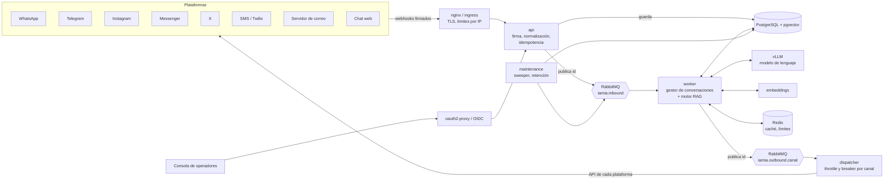
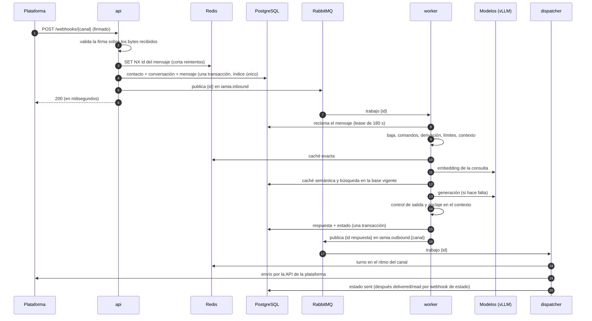
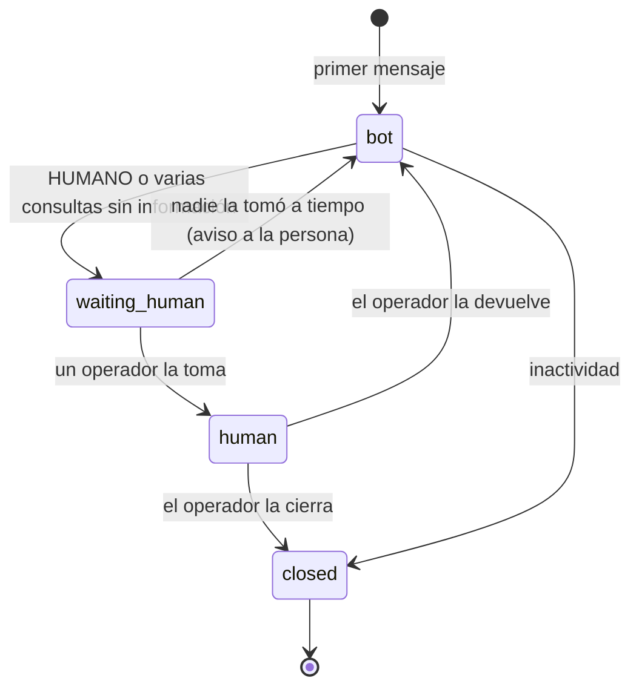

# Arquitectura

IAMiArgentina 1.1 es un asistente de trámites que atiende por ocho canales (WhatsApp, Telegram,
Instagram, Messenger, mensajes directos de X, chat web, correo y SMS) con un motor de respuesta
que usa solo información oficial. Este documento explica cómo está armado, por qué y qué
garantiza. Las decisiones importantes tienen su registro en [decisiones/](decisiones/).

## Vista general

Un solo paquete de Python y una sola imagen, con roles que se eligen al arrancar
([ADR 0001](decisiones/0001-monolito-modular.md)):

| Rol | Responsabilidad | Escala con |
|---|---|---|
| `api` | webhooks de los 8 canales, chat web, `/v1/chat` (compatible con la v1), API de la consola, salud y métricas | CPU (HPA) |
| `worker` | reclama cada mensaje, decide la respuesta (comandos, derivación, contexto, motor RAG) y la deja lista para enviar | largo de `iamia.inbound` (KEDA) |
| `dispatcher` | envía las respuestas por cada plataforma, con ritmo, reintentos y circuit breaker por canal | largo de las colas de salida (KEDA); WhatsApp en su propio deployment |
| `maintenance` | sweeper, derivaciones vencidas, borrados pedidos, retención, limpieza de cachés y versiones viejas | una réplica (tareas idempotentes) |
| `migrate`, `ingest` | migraciones del esquema e ingesta de la base de conocimiento | Job / CronJob |

## Recorrido de un mensaje

Lo que viaja por la cola son solo identificadores: el texto vive cifrado en PostgreSQL.

## Gateway y adaptadores

Cada canal es un adaptador (`integrations/<canal>/adapter.py`) que implementa los contratos de
`channels/contracts.py`:

- **Verificación**: firma HMAC de Meta (`X-Hub-Signature-256`), secreto de Telegram, firma HMAC
  de X (más la respuesta al desafío CRC), firma de Twilio, firma con timestamp del puente de
  correo, token firmado del chat web.
  Siempre sobre los bytes recibidos y con comparación en tiempo constante.
- **Normalización**: el webhook se traduce a `InboundMessage` (canal, id del proveedor,
  remitente, tipo, texto, hilo, asunto). Los estados de entrega (`sent`, `delivered`, `read`,
  `failed`) se traducen a `StatusUpdate` y solo avanzan, nunca retroceden.
- **Envío**: cada adaptador sabe partir textos largos, aplicar las reglas de la plataforma
  (ventana de 24 h de WhatsApp con plantilla de reenganche, etiqueta `HUMAN_AGENT` de Meta,
  hilo del correo) y clasificar los errores del proveedor.

El detalle por canal (credenciales, permisos, límites, cómo dar de alta cada webhook) está en
[docs/integrations](../integrations/README.md).

## Gestor de conversaciones

Orden de decisión para cada mensaje (`conversations/manager.py`):

1. **Baja**: si la persona pidió no recibir mensajes, solo se atiende `ALTA`.
2. **Comandos**: `AYUDA`, `HUMANO`, `PRIVACIDAD`, `BORRAR` (con confirmación), `VINCULAR`,
   `BAJA`, `ALTA`. Tienen que ser todo el mensaje: "¿cómo doy de baja la tarjeta?" es una
   consulta. Un saludo solo ("Hola", "Buenas tardes") recibe la bienvenida sin pasar por el
   motor.
3. **Derivación**: si un operador tiene la conversación, el bot no contesta.
4. **Límites por contacto**: 8 por minuto y 300 por día (anti-spam y anti-bucles entre bots).
5. **Contenido no textual**: se avisa que solo se lee texto.
6. **Contexto**: una pregunta que depende de lo anterior ("¿y cuánto sale?") se reescribe como
   pregunta completa con los últimos turnos. Si la reescritura falla, se usa el mensaje tal cual.
7. **Motor RAG**. Después de dos consultas seguidas sin información se ofrece hablar con una
   persona.

El gestor no guarda nada: devuelve una decisión que el worker persiste en una transacción. Las
conversaciones de distintos canales solo se unen si la persona lo pide con un código de un solo
uso ([ADR 0005](decisiones/0005-vinculacion-explicita-de-identidades.md)).

## Motor de respuesta (RAG)

Corta lo antes posible para no gastar GPU (`ai/engine.py`):

| Paso | Qué hace | Si corta |
|---|---|---|
| Limpieza | normaliza Unicode, saca caracteres invisibles, limita largo | pedido inválido |
| Manipulación | reglas contra prompt injection | respuesta fija, `blocked` |
| Datos personales | enmascara DNI, CUIL, teléfonos, correos, tarjetas, CBU, pasaporte antes de seguir | — |
| Caché exacta | Redis, clave con versión de la base, del prompt y del modelo | respuesta cacheada |
| Caché semántica | pgvector, similitud ≥ 0,95 | respuesta cacheada |
| Recuperación | top 4 fragmentos de la base vigente con umbral de relevancia y margen | `no_info` / fuera de tema |
| Single-flight | una sola generación por pregunta igual en curso; el resto espera | — |
| Presupuesto | tokens por cliente por día | cupo agotado |
| Circuit breaker y compuerta | protege al modelo; límite de llamadas concurrentes | `ServiceBusy` → reintento |
| Generación | vLLM con system prompt blindado y el contexto delimitado | — |
| Control de salida | fuga del prompt, código canario, enlaces solo a `gob.ar` | `refused` |
| Anclaje | la respuesta tiene que apoyarse en el contexto recuperado | observa o bloquea |

La base de conocimiento se carga con `python -m iamia ingest` desde FAQs propias y páginas
oficiales listadas, en una tabla nueva por versión con índice HNSW. Se valida y recién entonces
se cambia el puntero `kb_active` (azul/verde, con vuelta atrás).

## Datos

| Tabla | Contenido | Protección |
|---|---|---|
| `contacts` | dirección por canal, nombre, opt-out | dirección cifrada (AES-256-GCM) + HMAC para buscar |
| `persons` | agrupa contactos vinculados por la persona | — |
| `conversations` | estado, operador asignado, hilo, asunto | — |
| `messages` | entrada y salida con estado, lease, intentos, ids del proveedor | texto enmascarado y cifrado |
| `audit_log` | quién hizo qué en la consola | solo lectura para el auditor |
| `link_codes` | códigos de vinculación | un solo uso, con vencimiento |
| `oauth_tokens` | tokens de X que rotan | cifrados, lock entre procesos |
| `kb_versions`, `kb_active`, `kb_chunks_<versión>` | base de conocimiento versionada | solo escribe la ingesta |
| `key_rotation` | avance del recifrado después de rotar la clave | — |

Retención por defecto: mensajes 90 días, contactos inactivos 180 días, auditoría 365 días
(configurable). Cada dato cifrado lleva el id de su clave: al rotarla, el mantenimiento recifra lo
viejo en segundo plano. El detalle de cifrado, claves y Ley 25.326 está en
[docs/security](../security/README.md).

## Garantías

- **Ningún mensaje guardado queda sin procesar.** Se guarda antes de publicar; el sweeper
  republica lo que no llegó a la cola y libera los leases vencidos
  ([ADR 0004](decisiones/0004-bandeja-de-salida-y-sweeper.md)).
- **Nadie recibe dos veces la misma respuesta.** Deduplicación en Redis y en PostgreSQL a la
  entrada; reclamo con lease y dueño para procesar; progreso por partes para enviar.
- **Un canal no frena a los otros.** Cola, throttle y circuit breaker propios por canal; el
  dispatcher de WhatsApp corre aparte en Kubernetes.
- **La API siempre contesta rápido.** Solo valida, guarda y publica. Si PostgreSQL no responde
  contesta 503 con `Retry-After` y la plataforma reintenta.

## Resiliencia

| Patrón | Dónde |
|---|---|
| Reintentos con backoff exponencial y jitter | envío por canal, motor (errores transitorios) |
| Reintentos con espera en el broker | niveles 1 s a 30 min sin plugins ([ADR 0002](decisiones/0002-rabbitmq-colas-quorum.md)) |
| Cola de descarte (DLQ) | `iamia.dead.inbound` / `iamia.dead.outbound`; los mensajes fallidos aparecen en la consola (Problemas) y se pueden reintentar |
| Circuit breaker | por canal y para el modelo |
| Contrapresión | colas con largo máximo y `reject-publish`; el sweeper reintenta |
| Idempotencia | Redis `SET NX` + índice único; estados que solo avanzan |
| Single-flight | una generación por pregunta igual |
| Cachés | exacta (Redis) y semántica (pgvector); si Redis falla, sigue sin caché |
| Aislamiento | colas y deployments por canal, NetworkPolicy por componente |
| Timeouts | en cada llamada externa (modelo, embeddings, plataformas, base) |
| Fallas no previstas | vuelven con espera y terminan en la DLQ ([ADR 0007](decisiones/0007-reintentos-de-fallas-no-previstas.md)) |

## Escalado y capacidad

La API no hace trabajo pesado, así que escala horizontal sin límite práctico. El cuello de
botella real es la generación en GPU; las cachés y el umbral de relevancia existen para no
llegar al modelo cuando no hace falta. Medido en una máquina de 6 vCPU con modelo simulado, la
plataforma sostiene alrededor de 100 mensajes/s antes de que crezca la cola; el detalle y la
proyección a escala nacional están en el [plan de hardware y capacidad](../hardware/README.md#capacidad).

## Observabilidad

- **Métricas** Prometheus en cada proceso (`/metrics`): pedidos y latencia por ruta, mensajes por
  canal y resultado, colas, reintentos, DLQ, circuit breakers, cachés, latencia y tokens del
  modelo. Tres tableros de Grafana (aplicación, motor de IA, infraestructura y GPU) y reglas de
  alerta con su runbook.
- **Logs** en JSON, una línea por evento, con `trace_id`, canal y rol; nunca texto ni
  direcciones. Alloy los manda a Loki.
- **Trazas** OpenTelemetry opcionales, con el id del mensaje como id de traza
  ([ADR 0008](decisiones/0008-trazas-con-el-id-del-mensaje.md)): una sola traza por mensaje
  aunque pase por tres procesos.
- **Salud**: `/health/live` y `/health/ready` (base, Redis y cola) en la API y servidor de salud
  propio en cada worker.

Configuración en [infrastructure/monitoring](../../infrastructure/monitoring/README.md);
qué hacer con cada alerta en el [manual de operación](../manual/runbooks.md).

## Decisiones

| N.º | Decisión |
|---|---|
| [0001](decisiones/0001-monolito-modular.md) | Monolito modular con roles en lugar de microservicios |
| [0002](decisiones/0002-rabbitmq-colas-quorum.md) | RabbitMQ con colas quorum para el trabajo asincrónico |
| [0003](decisiones/0003-postgresql-pgvector.md) | PostgreSQL con pgvector como base de datos y base vectorial |
| [0004](decisiones/0004-bandeja-de-salida-y-sweeper.md) | Guardar primero, publicar después: bandeja de salida, leases y sweeper |
| [0005](decisiones/0005-vinculacion-explicita-de-identidades.md) | Las identidades de distintos canales solo se vinculan si la persona lo pide |
| [0006](decisiones/0006-modelos-locales.md) | Modelos en servidores propios, detrás de una API compatible con OpenAI |
| [0007](decisiones/0007-reintentos-de-fallas-no-previstas.md) | Un trabajo que falla sin explicación vuelve con espera y termina en la DLQ |
| [0008](decisiones/0008-trazas-con-el-id-del-mensaje.md) | Trazas de OpenTelemetry con el id del mensaje como id de traza |
