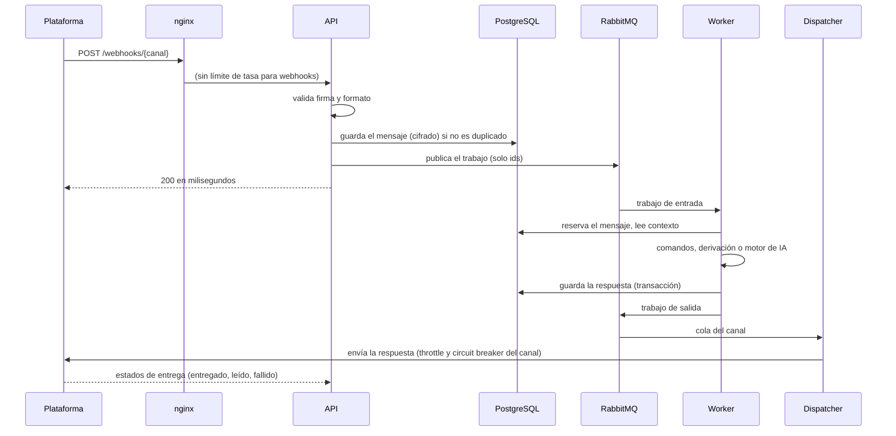

# Canales

IAMiArgentina atiende ocho canales con el mismo motor y la misma lógica de conversación. Cada
canal es un adaptador en `backend/iamia/integrations/<canal>/` que sabe cuatro cosas: validar el
webhook, traducirlo a un mensaje interno, dar formato a la respuesta y enviarla. Todo lo demás
(idempotencia, colas, reintentos, derivación a personas, auditoría) es común.

Los datos de plataformas externas (límites, precios, plazos) están tomados de su documentación a
noviembre de 2026. Cambian seguido: revisarlos antes de habilitar un canal en producción.

## Resumen

| Canal | Entrada | Validación | Clave de idempotencia | Límite de envío (por defecto) | Restricción principal |
|---|---|---|---|---|---|
| WhatsApp | webhook de Cloud API | `X-Hub-Signature-256` (HMAC-SHA256 del app secret) | `wamid` | 80 msg/s | ventana de 24 h; fuera de ella, solo plantillas aprobadas |
| Messenger | webhook de la página | `X-Hub-Signature-256` | `mid` | 40 msg/s | ventana de 24 h; después, solo una persona hasta 7 días (HUMAN_AGENT) |
| Instagram | webhook (Instagram API with Unified Login) | `X-Hub-Signature-256` | `mid` | 40 msg/s | igual que Messenger; 1000 bytes por mensaje |
| Telegram | webhook del bot | `X-Telegram-Bot-Api-Secret-Token` | `update_id` | 25 msg/s | solo chats privados |
| X | X Activity API (`dm.received`) | firma HMAC de X y CRC | id del evento | 15 cada 15 min y 1440 por día | aprobación previa de X para respuestas con IA |
| SMS | webhook de Twilio | `X-Twilio-Signature` (HMAC-SHA1) | `MessageSid` | 10 msg/s | 3 segmentos por respuesta, texto en GSM-7 |
| Correo | `POST /webhooks/email` desde el servidor de correo | HMAC-SHA256 con timestamp (5 min) | `Message-ID` | 10 msg/s | se ignoran respuestas automáticas y rebotes |
| Chat web | API propia (`/webchat/...`) | token de sesión firmado | id generado por el navegador | — | 30 sesiones nuevas por IP por hora |

Los límites de envío se cambian con `CHANNEL_RATE_LIMITS` (formato `canal=mensajes/segundos`,
varias ventanas separadas por `;`). Se aplican en el dispatcher de cada canal, compartidos entre
réplicas a través de Redis.

## Flujo común



Puntos que valen para todos los canales:

- **Responder rápido a la plataforma.** La API solo valida, guarda y encola. Meta desactiva un
  webhook que falla durante una hora y Messenger exige respuesta en menos de 5 s; con este diseño
  la API contesta en milisegundos aunque el modelo tarde.
- **Duplicados.** Las plataformas reintentan. Cada mensaje se identifica con la clave del canal
  (tabla de arriba): primero se descarta en Redis (`SET NX`) y, si Redis no está, la restricción
  única de PostgreSQL hace el mismo trabajo. El mismo webhook recibido tres veces genera una sola
  respuesta (hay una prueba de punta a punta para eso).
- **Firma sobre los bytes recibidos.** Se valida antes de interpretar el cuerpo y en tiempo
  constante. Un webhook sin firma, con firma vieja o de otro secreto se rechaza con 401 y suma a
  `iamia_webhook_rejected_total`.
- **Datos personales.** El texto se enmascara (DNI, CUIL, teléfono, correo, tarjeta, CBU) antes
  de guardarlo y se cifra con AES-GCM. Las direcciones (teléfono, usuario, correo) se guardan
  cifradas y se buscan por un hash con clave (HMAC), nunca en claro. Los adjuntos no se descargan:
  se registra solo el tipo.
- **Estados.** Los estados de entrega que mandan las plataformas solo avanzan (enviado →
  entregado → leído); uno viejo que llega tarde no pisa a uno nuevo.
- **Fallas.** Un error transitorio se reintenta con espera creciente; un 429 respeta el
  `Retry-After` de la plataforma; un error permanente queda en la consola ("Problemas de envío");
  un error de credenciales abre el circuito del canal sin afectar a los demás.

## Habilitar un canal

1. Completar sus variables en `.env` (o en el gestor de secretos) y agregarlo a `CHANNELS_ENABLED`.
2. Revisar la configuración: `docker compose run --rm --no-deps api check-config`. Avisa si falta un
   secreto o si hay valores de ejemplo.
3. Registrar el webhook en la plataforma con la URL pública `https://<host>/webhooks/<canal>`.
4. Mandar un mensaje de prueba y seguirlo en la consola.

Para probar sin cuentas reales están los simuladores de `tests/e2e/simulators/`: reciben los
envíos como lo haría cada plataforma y pueden inyectar fallas (500, 429, credenciales vencidas).

## WhatsApp

**Cuenta.** WhatsApp Business Platform (Cloud API) con un número propio, una app de Meta y un
usuario de sistema del portfolio de negocio con permiso `whatsapp_business_messaging`.

**Variables.** `WHATSAPP_PHONE_NUMBER_ID`, `WHATSAPP_ACCESS_TOKEN` (token del usuario de sistema),
`WHATSAPP_APP_SECRET`, `WHATSAPP_VERIFY_TOKEN` y opcionalmente `WHATSAPP_REENGAGEMENT_TEMPLATE`.

**Webhook.** En la app de Meta, producto WhatsApp → Configuración: URL
`https://<host>/webhooks/whatsapp`, el mismo verify token y suscripción al campo `messages`.

**Identidad (BSUID).** Desde 2026 los mensajes traen un identificador por portfolio de negocio
(`from_user_id`) y el teléfono puede no venir si la persona usa nombre de usuario. El sistema usa
el BSUID como clave principal y responde con él; si el BSUID cambia, llega un aviso de sistema y
el contacto se reasocia sin perder la conversación.

**Ventana de 24 h.** Se puede responder libremente dentro de las 24 h posteriores al último
mensaje de la persona. Fuera de ese plazo solo se pueden mandar plantillas aprobadas: si se
configura una plantilla de categoría utilidad con una variable en el cuerpo, el sistema la usa
para retomar el contacto; si no, el envío queda en "Problemas de envío" como `window_closed`.

**Costos.** Meta cobra por plantilla entregada, según categoría y país. Las respuestas dentro de
la ventana de atención (lo que hace el asistente casi siempre) no tienen costo. Verificar la
tarifa vigente para Argentina.

**Experiencia.** Mientras se genera la respuesta el mensaje se marca como leído y aparece
"escribiendo...". El texto respeta el formato de WhatsApp (negrita con `*`, sin HTML).

## Messenger e Instagram

Comparten formato de webhook y API de envío, así que usan el mismo adaptador base
(`integrations/meta/`).

**Messenger.** Página de Facebook con la app conectada. Variables `MESSENGER_PAGE_ID`,
`MESSENGER_PAGE_ACCESS_TOKEN`, `MESSENGER_APP_SECRET`, `MESSENGER_VERIFY_TOKEN`. Webhook en
`https://<host>/webhooks/messenger`, campos `messages` y `messaging_postbacks`.

**Instagram.** Cuenta profesional con "Permitir acceso a los mensajes" activado, conectada por
Instagram API with Unified Login (la opción que Meta indica para integraciones nuevas). Variables
`INSTAGRAM_ACCOUNT_ID`, `INSTAGRAM_ACCESS_TOKEN`, `INSTAGRAM_APP_SECRET`,
`INSTAGRAM_VERIFY_TOKEN`. El texto admite 1000 bytes UTF-8 por mensaje (las tildes ocupan dos):
las respuestas largas se dividen en partes.

**Ventana.** Respuesta libre dentro de las 24 h. Después, solo una persona puede responder, hasta
7 días, con la etiqueta HUMAN_AGENT; requiere que Meta apruebe la función Human Agent y se activa
con `MESSENGER_HUMAN_AGENT_TAG` / `INSTAGRAM_HUMAN_AGENT_TAG`. El asistente nunca usa la
etiqueta. Desde abril de 2026 las otras etiquetas de mensajes (actualizaciones de cuenta,
eventos, compras) devuelven error.

**App en modo Live** con acceso avanzado a los permisos de mensajería; en modo desarrollo solo
responde a cuentas de prueba.

## Telegram

**Bot.** Se crea con @BotFather. Variables `TELEGRAM_BOT_TOKEN` y `TELEGRAM_WEBHOOK_SECRET`
(una cadena aleatoria que Telegram manda en cada webhook).

**Webhook.**

```bash
curl -sS "https://api.telegram.org/bot${TELEGRAM_BOT_TOKEN}/setWebhook" \
  --data-urlencode "url=https://<host>/webhooks/telegram" \
  --data-urlencode "secret_token=${TELEGRAM_WEBHOOK_SECRET}" \
  --data-urlencode 'allowed_updates=["message"]'
```

Solo se atienden chats privados: en grupos el bot no responde (alcance y privacidad). Documentos,
fotos y audios se registran solo con el tipo.

## X (mensajes directos)

**Acceso.** Cuenta de desarrollador con acceso a la API de mensajes directos (el acceso es pago y
el costo depende del plan vigente) y una app con OAuth 2.0 y permisos `dm.read`, `dm.write`,
`users.read` y `offline.access`. Según la política de X, las respuestas generadas con IA en DMs
necesitan aprobación previa: tramitarla antes de habilitar el canal.

**Variables.** `X_ACCOUNT_ID`, `X_WEBHOOK_SECRET`, `X_CLIENT_ID`, `X_CLIENT_SECRET`,
`X_OAUTH_REDIRECT_URI` y `X_TOKEN_MODE=refresh`.

**Autorización inicial.** `docker compose run --rm api x-authorize` imprime la URL de
autorización (OAuth 2.0 con PKCE); se abre con la cuenta de X de la organización y el token de
actualización queda guardado cifrado en la base. Después se renueva solo.

**Webhook.** Suscripción `dm.received` de la X Activity API a `https://<host>/webhooks/x`. La
plataforma valida la URL con un CRC (GET con `crc_token`) que la API responde sola. Durante la
transición se acepta también el formato de la Account Activity API, que X da de baja el
28/2/2027.

**Límites.** 15 mensajes cada 15 minutos y 1440 por día para toda la cuenta. Es el canal de menor
capacidad: el excedente espera en la cola `iamia.outbound.x` y sale cuando hay cupo. Conviene
publicar en el perfil que la respuesta puede demorar y ofrecer otros canales.

## SMS

**Proveedor.** Twilio o uno con la misma API. Variables `TWILIO_ACCOUNT_SID`, `TWILIO_AUTH_TOKEN`,
`TWILIO_FROM_NUMBER` (o `TWILIO_MESSAGING_SERVICE_SID`) y `SMS_WEBHOOK_URL`.

**Webhook.** En el número (o servicio de mensajería), "A message comes in" → POST a
`https://<host>/webhooks/sms`. `SMS_WEBHOOK_URL` tiene que ser exactamente esa URL: Twilio firma
la URL pública y, detrás de proxies, la que ve el servidor no coincide. El mismo endpoint recibe
los estados de entrega.

**Texto.** Las respuestas se pasan a GSM-7 (las tildes agudas pasan el SMS a UCS-2, con la mitad
de caracteres por segmento) y se recortan a `SMS_MAX_SEGMENTS` (3). Los enlaces largos ocupan
mucho: las FAQ que se usan por SMS conviene que tengan respuestas cortas.

**Antes de producción.** Consultar con el proveedor los requisitos para enviar a números
argentinos (registro del remitente y del caso de uso).

## Correo electrónico

**Entrada.** No hace falta exponer IMAP ni guardar contraseñas de buzones: el servidor de correo
de la organización entrega cada mensaje dirigido al asistente a `scripts/email-a-iamia.py`, que
lo firma (HMAC-SHA256 con timestamp, válido 5 minutos) y lo publica en
`https://<host>/webhooks/email`. El script usa solo la biblioteca estándar de Python 3, devuelve a
Postfix los códigos que entiende (75 = reintentar más tarde) y, si el correo supera 3 MB, manda
los adjuntos vacíos (el asistente solo lee el texto). La configuración de Postfix está en el
encabezado del script.

**Salida.** SMTP autenticado con STARTTLS (`SMTP_HOST`, `SMTP_PORT`, `SMTP_USERNAME`,
`SMTP_PASSWORD`, `EMAIL_FROM_ADDRESS`), en el mismo hilo (`In-Reply-To` y `References`).

**Bucles.** Se ignoran respuestas automáticas (`Auto-Submitted`, `Precedence: bulk`, avisos de
ausencia) y rebotes (`MAILER-DAEMON`), para que dos sistemas automáticos no se respondan entre sí.

**Antes de producción.** SPF, DKIM y DMARC del dominio remitente; sin eso las respuestas terminan
en spam.

## Chat web

No hay plataforma externa. La página `/chat/` la sirve la misma API y usa tres endpoints:

- `POST /webchat/sessions`: crea una sesión y devuelve un token firmado (HMAC con
  `WEBCHAT_TOKEN_SECRET`, vence a las 24 h). Hasta 30 sesiones nuevas por IP por hora.
- `POST /webchat/messages`: manda un mensaje (entra por el mismo camino que el resto de los
  canales: cola, worker, motor).
- `GET /webchat/messages?after=<n>`: long polling de hasta 25 s. Cuando el worker guarda la
  respuesta, avisa por Redis Pub/Sub a la réplica de la API que tiene al navegador esperando.

La página no usa scripts de terceros, ni estilos o scripts en línea, y tiene una Content
Security Policy estricta (`script-src 'self'`).

`/v1/chat` es aparte: una consulta de un solo turno, sin conversación, pensada para integrar el
asistente en otra aplicación detrás del borde (requiere el encabezado `X-Edge-Auth` que agrega
nginx). Es el mismo motor y la misma caché.
